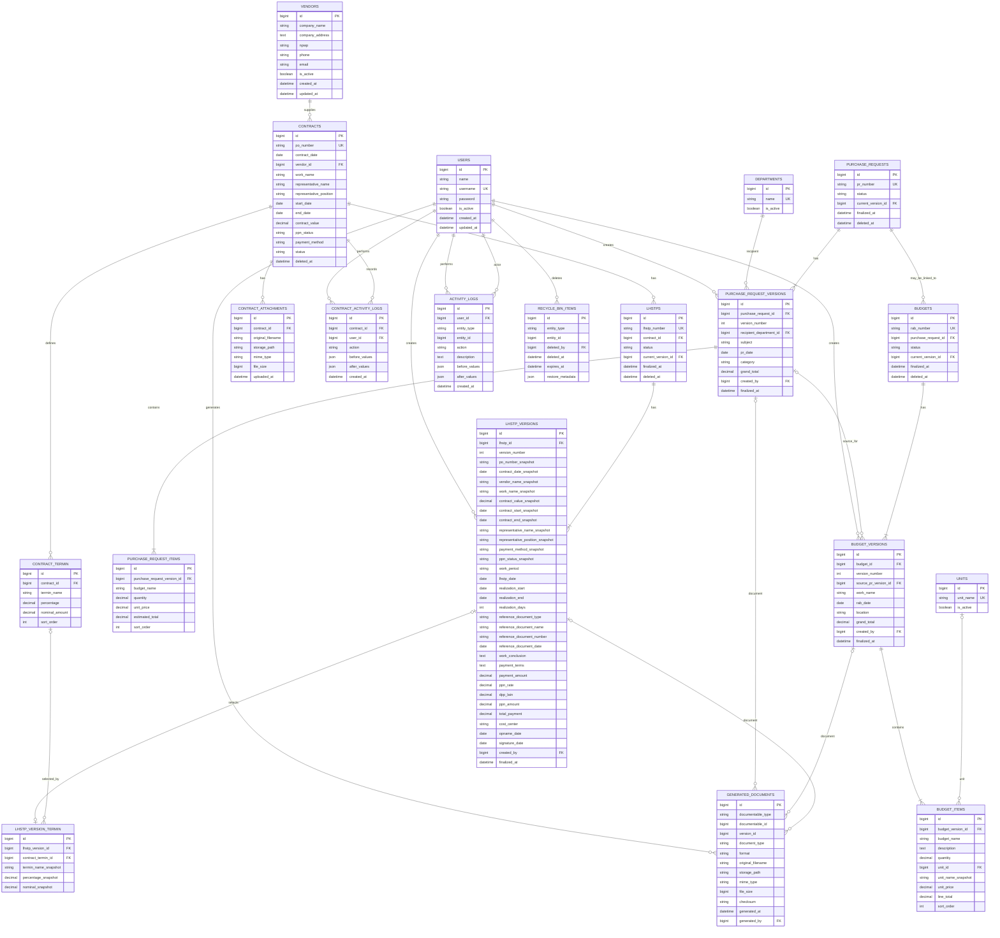

# Entity Relationship Diagram (ERD)
## ITMS Administrative Management Web Application

**Status:** Proposed logical data model for review  
**Version:** 0.1  
**Related documents:** ITMS Administrative App PRD Draft v0.2; Technical Design Document v0.1

This ERD translates the approved business requirements into a proposed relational structure. It is a logical design, not yet an executable migration set. Physical column definitions, indexes, delete behavior, and constraints will be finalized before database migrations are written.

## 1. Design principles

1. Business document numbers are separate from database primary keys.
2. PR, RAB, and LHSTP use a stable parent record plus immutable version records.
3. Finalized versions are historical snapshots and must not be overwritten.
4. Contract edits update current contract data and are recorded in contract activity history. LHSTP versions preserve snapshots of the contract values used when they were created.
5. Money uses fixed-precision decimal types, never floating point.
6. Uploaded and generated files are stored outside the public web root; MySQL stores file metadata and private storage paths.
7. Shared Recycle Bin behavior is implemented through soft deletion and a central deletion registry. Permanent deletion must respect dependencies and retention rules.
8. This design does not reuse the legacy database schema. The new database will be `itms_admin_db`.

## 2. ERD

## 3. Table groups and key decisions

### 3.1 Master data

- `vendors`: reusable vendor/company details. Representative name and position are not stored here; they belong to each contract.
- `departments`: reusable department list used by PR recipient selection.
- `units`: reusable RAB units. RAB items also store `unit_name_snapshot` so old documents remain readable if a unit label is later renamed.
- `users`: one account for the initial release, with a structure that does not prevent adding more accounts later.

### 3.2 Purchase Requisition

- `purchase_requests` stores the permanent PR number and current lifecycle state.
- `purchase_request_versions` stores a complete header snapshot for each revision.
- `purchase_request_items` stores the line items for one version.
- `current_version_id` points to the currently active version; it must reference a version belonging to the same parent PR.
- A finalized version is immutable.

### 3.3 RAB

- `budgets` stores the permanent RAB number and optional link to one PR.
- `budget_versions` stores each RAB revision and the source PR version used for import, if any.
- `budget_items` stores item-level details.
- When RAB is created from PR, every PR item is imported. The stored PR unit price is copied directly; no unit price is reverse-calculated from the line total.
- RAB edits never update PR.
- If linked to a PR, the RAB total must equal the linked PR total before finalization.

### 3.4 Contract

- `contracts.po_number` is unique and is the primary business identifier.
- One vendor can have multiple contracts; each contract belongs to one vendor.
- Contract representative fields are stored on the contract, not the vendor.
- `contract_termin` is used for the Termin payment method.
- `contract_attachments` stores the main contract and addenda as separate PDF attachments.
- `contract_activity_logs` records the contract changes identified in the PRD.

### 3.5 LHSTP

- `lhstps` stores the permanent LHSTP number and links to one contract.
- `lhstp_versions` stores the full snapshot of contract values and all LHSTP-specific inputs/calculations for each version.
- `lhstp_version_termin` records the single selected termin for that LHSTP version, when the contract payment method is Termin.
- Each version can generate a PDF, DOCX, or both. Generated documents point to the exact version.
- Contract edits after an LHSTP is created must not change any existing LHSTP version.

### 3.6 Generated documents

A shared `generated_documents` table is proposed instead of separate PR/RAB/LHSTP document tables.

- `documentable_type` and `documentable_id` identify the parent business record.
- `version_id` identifies the exact PR/RAB/LHSTP version.
- `document_type` identifies the output purpose (e.g. final document).
- `format` identifies PDF or DOCX.
- A checksum helps detect accidental file replacement or corruption.

Because a polymorphic relationship cannot be protected by a conventional foreign key to several parent tables, the application service must validate the parent/version relationship before creating or deleting document records.

### 3.7 Recycle Bin

`recycle_bin_items` is a shared registry for soft-deleted records. The application must not hard-delete a record merely because its 30-day timer has expired if retained dependent records or legal/operational history would be orphaned. The purge workflow must verify dependency rules and either safely purge a complete eligible aggregate or report that the item is protected pending an explicit retention rule.

## 4. Important constraints and indexes

The following constraints are recommended:

- Unique: `purchase_requests.pr_number`.
- Unique: `budgets.rab_number`.
- Unique: `contracts.po_number`.
- Unique: `lhstps.lhstp_number` for distinct LHSTP parent records.
- Unique composite: `(purchase_request_id, version_number)`.
- Unique composite: `(budget_id, version_number)`.
- Unique composite: `(lhstp_id, version_number)`.
- Unique: `(vendors.company_name)` may be enforced after confirming the business rule for duplicate-name warnings; initially use normalized duplicate detection and a warning.
- Unique: `(units.unit_name)` and `(departments.name)`.
- Index foreign keys and commonly searched fields: PO number, vendor, work name, PR/RAB/LHSTP number, status, relevant dates.
- Contract termin percentages and nominal amounts must be nonnegative; the aggregate 100% rule is enforced by a transactional application service because a row-level CHECK cannot validate the sum of sibling rows.
- Quantities must be greater than zero; unit prices must not be negative.
- Currency uses `DECIMAL(18,2)`; quantity uses `DECIMAL(15,3)`.

## 5. Deletion and retention notes requiring implementation care

- Soft-delete eligible parent records and register them in `recycle_bin_items`.
- Restore must restore the same aggregate and preserve its children/history.
- The 30-day expiry is measured from `deleted_at`.
- Final and Archived PR/RAB/LHSTP records are protected from permanent deletion under the agreed lifecycle rules.
- Contract deletion must not destroy LHSTP snapshots or activity history.
- Before implementation, the exact aggregate purge policy must be mapped for each entity type. A safe default is to block permanent purge where dependencies cannot be removed without violating a retention rule.

## 6. Questions intentionally deferred

The following are implementation details, not blockers for the logical ERD:

- Exact physical column lengths and all nullable/default settings.
- Whether version numbers are generated with a database lock or another concurrency-safe method.
- Exact indexes for dashboard filters after query design.
- Whether `document_type` needs a lookup table or a constrained enum.
- Final strategy for purging records with cross-module dependencies.
- Whether the application stores all calculated totals or recalculates and verifies them on read. Recommended: store finalized totals as snapshots and verify calculations in tests.

## 7. Next step

Review the logical model and then produce Laravel migrations in dependency order. Before migrations are run, validate the few cross-module retention and deletion edge cases against the PRD.
